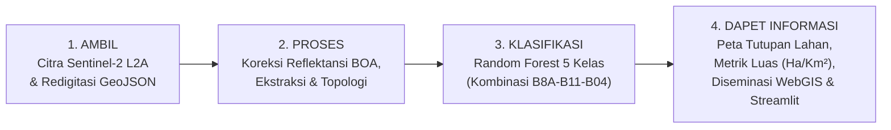
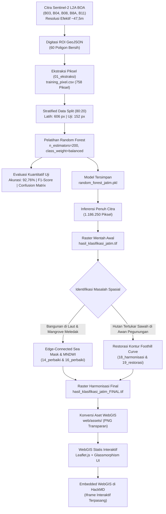
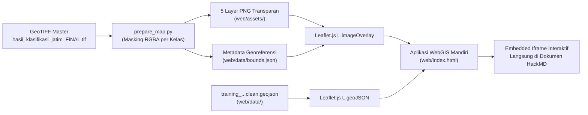
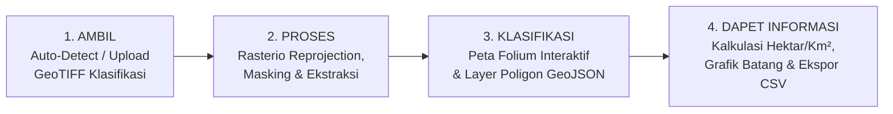

# UTS 
## Klasifikasi Tutupan Lahan Jawa Timur Berbasis Citra Satelit Sentinel-2 dan Algoritma Random Forest


---


---

## 1. Header dan Informasi Proyek

| Parameter Proyek | Deskripsi Teknis |
| :--- | :--- |
| **Judul Proyek** | Klasifikasi Tutupan Lahan Berbasis Citra Satelit Sentinel-2 dan Algoritma Random Forest |
| **Fokus Wilayah** | Kabupaten Banyuwangi dan Sekitarnya (Jawa Timur Bagian Timur) |
| **Sensor Satelit** | MultiSpectral Instrument (MSI) Sentinel-2 Level-2A (ESA Copernicus) |
| **Tanggal Perekaman** | 6 Oktober 2026 |
| **Algoritma Klasifikasi** | Random Forest Classifier (`sklearn.ensemble.RandomForestClassifier`) |
| **Jumlah Kelas** | 5 Kelas (*Building, Farmland, Water, Forest, Mangrove*) |
| **Akurasi Model Uji** | **92,76%** (*Overall Accuracy* pada 152 piksel testing independen) |
| **Raster Master Final** | `hasil_klasifikasi_jatim_FINAL.tif` (1.186.250 piksel, WGS 84) |
| **Platform Diseminasi** | WebGIS Statis Interaktif (Leaflet.js) & Dashboard Analitik Python (Streamlit) |
| **Status Live Demo Streamlit** | 🚀 [**Buka Dashboard Streamlit Publik (Streamlit Cloud)**](https://utspsd-rvcxnt7h3agxnkbylm298z.streamlit.app/) |
| **Status Live Demo WebGIS** | 🗺️ [**Buka WebGIS Leaflet Publik (GitHub Pages)**](https://aisya08.github.io/UTS_PSD/web/) |

---

## 3. Pendahuluan dan Business Understanding

### 3.1 Latar Belakang dan Konteks Tugas (Pengganti UTS)
Proyek ini dikembangkan sebagai bagian dari **Tugas Pengganti Ujian Tengah Semester (UTS)** mata kuliah Penginderaan Jauh & Sains Data Spasial. Sasaran utama tugas ini adalah melakukan pemetaan permukaan bumi di wilayah **Jawa Timur** (difokuskan pada bentang alam representatif Kabupaten Banyuwangi dan sekitarnya) menggunakan citra satelit multispektral Sentinel-2 Level-2A (*Bottom of Atmosphere / BOA Surface Reflectance*) dan algoritma *machine learning*.

Dalam penugasan ini, ditekankan pentingnya proses **digitasi ulang (*redigitasi*) poligon sampel *Region of Interest* (ROI)** dalam jumlah yang memadai (*jumlah data harus banyak*) untuk menyusun dataset latih yang berkualitas tinggi hingga menghasilkan model klasifikasi dengan akurasi yang unggul.

### 3.2 Alur Operasional Bisnis: Ambil - Proses - Klasifikasi - Dapet Informasi
Proyek ini mengadopsi kerangka kerja sistemik berorientasi luaran dengan alur operasional utama:



1. **AMBIL (Data Ingestion & Digitasi):**
   - Mengambil kanal citra multispektral Sentinel-2 L2A (B03, B04, B08, B8A, B11) tanggal perekaman 6 Oktober 2026.
   - Melakukan digitasi ulang poligon ROI manual pada 5 kelas tutupan lahan untuk memperkaya jumlah dan keragaman variasi piksel sampel.
2. **PROSES (Data Preparation & Extraction):**
   - Memvalidasi topologi dan membersihkan geometri poligon GeoJSON.
   - Menumpangkan poligon vektor di atas citra satelit dan mengekstrak nilai reflektansi piksel ke dalam dataset tabular `training_pixel.csv` (758 piksel).
3. **KLASIFIKASI (Model Training & Inference):**
   - Melatih model *Random Forest Classifier* dengan pembobotan seimbang (*balanced class weight*) dan 200 *estimators*.
   - Menerapkan inferensi model ke seluruh 1.186.250 piksel citra raster ($1.250 \times 949$).
   - Menjalankan rangkaian harmonisasi pascaklasifikasi berbasis aturan spektral dan geomorfologis untuk mengeliminasi anomali bangunan di laut lepas dan tutupan awan di puncak gunung.
4. **DAPET INFORMASI (Actionable Insights & Deployment):**
   - Memperoleh statistik luasan aktual tutupan lahan (dalam satuan piksel, hektar, dan kilometer persegi).
   - Menyajikan informasi spasial interaktif melalui WebGIS Leaflet (dengan fitur filter per layer) yang dapat disematkan ke dokumen HackMD, serta aplikasi dashboard analitik interaktif berbasis Python Streamlit.

### 3.3 Rasionalisasi Spektral: Kombinasi Band 8A - 11 - 4 untuk Membedakan Mangrove dan Hutan
Salah satu tantangan ilmiah utama dalam penugasan ini adalah **membedakan antara ekosistem Hutan Mangrove (*Mangrove*) dengan Hutan Daratan/Pegunungan Biasa (*Forest*)**. Secara visual optik alami (*true color*), kedua kelas ini tampak serupa sebagai vegetasi hijau rimbun. Namun, melalui pemanfaatan **kombinasi spektral Band 8A (Narrow NIR), Band 11 (SWIR-1), dan Band 04 (Red)**, kedua formasi vegetasi tersebut dapat dipisahkan secara tegas:

| Parameter Spektral | Band Sentinel-2 | Respon Hutan Biasa (*Forest*) | Respon Hutan Mangrove (*Mangrove*) | Mekanisme Pemisahan Spektral |
| :--- | :---: | :--- | :--- | :--- |
| **Narrow NIR** | **Band 8A** ($865\text{ nm}$) | Pantulan sangat tinggi dari kanopi multi-layer daun kering/sehat. | Pantulan tinggi dari sel mesofil daun mangrove, namun sedikit teredam oleh latar air payau. | Mengidentifikasi struktur kerapatan biomassa kanopi hijau. |
| **Short-Wave Infrared 1** | **Band 11** ($1610\text{ nm}$) | Pantulan moderat dari biomassa kanopi pohon darat dan tanah kering. | **Serapan sangat kuat (pantulan sangat rendah)** akibat kelembapan ekstrem substrat lumpur basah dan air pasang surut di bawah kanopi. | **Kanal pembeda paling krusial:** Air payau dan lumpur intertidal pada habitat mangrove menyerap radiasi SWIR secara masif. |
| **Red (Tampak Merah)** | **Band 04** ($665\text{ nm}$) | Serapan klorofil tinggi (pantulan rendah). | Serapan klorofil tinggi dengan pengaruh kekeruhan sedimen pesisir. | Membedakan vegetasi aktif dari material non-vegetasi (tanah terbuka/bangunan). |

Hasil analisis *Feature Importance* membuktikan bahwa kanal **B11 (SWIR-1) menyumbang 33,81%** dan **B8A (Narrow NIR) menyumbang 33,40%** (total kumulatif 67,21%), menegaskan bahwa kombinasi kedua kanal inilah pilar utama keberhasilan model dalam memisahkan mangrove dari hutan darat.

### 3.4 Rumusan Masalah
1. **Tumpang Tindih Spektral Antarkelas (*Spectral Overlap*):** Kemiripan respon spektral antara vegetasi alami rimbun (hutan pegunungan) dengan tanaman padi pada fase vegetatif aktif, serta kemiripan pantulan tanah bera sawah dengan material atap seng/beton perkotaan.
2. **Anomali Piksel Awan Kumulus dan Bayangan Relief Curam:** Citra optik memuat awan kumulus putih kecil dan bayangan topografi di lereng Gunung Ijen, Gunung Raung, dan Meru Betiri yang memicu salah prediksi menjadi bangunan atau sawah basah.
3. **Kesalahan Spasial Ekstrem Hasil Klasifikasi Mentah:** Kemunculan piksel permukiman palsu di tengah perairan laut Selat Bali dan ledakan kelas mangrove di laut lepas terbuka akibat turbiditas air laut dangkal.

### 3.5 Tujuan Proyek
1. Melakukan digitasi ulang poligon ROI GeoJSON dalam jumlah banyak (60 poligon) untuk 5 kelas tutupan lahan: *Building, Farmland, Water, Forest,* dan *Mangrove*.
2. Melatih dan mengevaluasi model klasifikasi *Random Forest* dengan kombinasi kanal B04, B08, B8A, dan B11 hingga mencapai akurasi uji tinggi di atas 90%.
3. Menganalisis dan menanggulangi anomali spasial hasil prediksi mentah melalui filter deterministik (MNDWI, *edge-connected sea mask*, dan *foothill curve*) tanpa mengubah poligon training.
4. Membangun platform diseminasi ganda:
   - **WebGIS Statis Leaflet.js:** Peta interaktif mandiri dengan filter checkbox 5 kelas independen, slider transparansi, dan embedded iframe langsung di HackMD.
   - **Dashboard Streamlit:** Aplikasi analitik interaktif Python yang memvisualisasikan peta, grafik luasan, serta fasilitas upload GeoTIFF mandiri.

### 3.6 Manfaat
- Menyediakan peta tutupan lahan terintegrasi untuk mendukung inventarisasi Lahan Pertanian Pangan Berkelanjutan (LP2B) di kawasan agraris Banyuwangi.
- Memberikan gambaran spasial kondisi tutupan kanopi hutan lindung dan kawasan konservasi mangrove di Semenanjung Alas Purwo.
- Memenuhi seluruh standar teknis dan kompetensi dalam penugasan Pengganti UTS Sains Data Spasial.

---

## 4. Data dan Wilayah Penelitian

### 4.1 Cakupan Geografis Aktual
Wilayah penelitian difokuskan pada **Kabupaten Banyuwangi dan sekitarnya (kawasan ujung timur Provinsi Jawa Timur)**, dan **bukan mencakup seluruh Provinsi Jawa Timur secara keseluruhan**. Penegasan batas ini didasarkan pada *bounding box* koordinat geografis aktual dari file raster GeoTIFF Sentinel-2 yang dianalisis dalam proyek ini.

Berdasarkan metadata georeferensi GeoTIFF aktual (`EPSG:4326`), batas koordinat wilayah penelitian adalah:
- **Batas Barat (*Min Longitude*):** $113{,}8721975^\circ\text{ E}$ (Lereng Pegunungan Raung dan Meru Betiri)
- **Batas Timur (*Max Longitude*):** $114{,}4115945^\circ\text{ E}$ (Perairan Selat Bali)
- **Batas Selatan (*Min Latitude*):** $-8{,}6024119^\circ\text{ S}$ (Samudra Hindia dan Ujung Semenanjung Alas Purwo)
- **Batas Utara (*Max Latitude*):** $-8{,}1971798^\circ\text{ S}$ (Lereng utara Gunung Ijen / Wongsorejo)
- **Titik Pusat Koordinat:** $-8{,}3997959^\circ\text{ S}, 114{,}1418960^\circ\text{ E}$
- **Dimensi Raster:** $1.250\text{ kolom} \times 949\text{ baris}$ (Total: $1.186.250\text{ piksel}$)
- **Bentang Geografis:** $\approx 59{,}9\text{ km (lebar)} \times 44{,}8\text{ km (panjang)}$
- **Estimasi Luas Area Cakupan:** $\approx 2.683\text{ km}^2$ ($\approx 268.300\text{ hektar}$)

### 4.2 Resolusi Asli Sensor vs Resolusi Efektif Raster
Penting untuk membedakan antara spesifikasi sensor asli Sentinel-2 dan format raster hasil unduhan yang benar-benar diproses dalam proyek ini:

1. **Resolusi Asli Sensor Sentinel-2 (MSI):**
   - Kanal tampak dan NIR lebar (B02, B03, B04, B08): $10\text{ meter}$.
   - Kanal Red Edge dan SWIR (B05, B06, B07, B8A, B11, B12): $20\text{ meter}$.
   - Kanal atmosferik (B01, B09, B10): $60\text{ meter}$.

2. **Resolusi Efektif Raster Hasil Unduhan di Workspace:**
   - Seluruh file citra GeoTIFF yang tersedia di workspace (`2026-10-06-..._Sentinel-2_L2A_B*.tiff`) telah di-resampling dan diunduh pada grid spasial seragam dengan sistem koordinat WGS 84 (`EPSG:4326`).
   - Ukuran piksel matematis dari metadata affine transform raster adalah:
     $$\Delta\text{Lon} = 0{,}0004315176^\circ \quad \text{dan} \quad \Delta\text{Lat} = 0{,}0004270096^\circ$$
   - Pada posisi lintang rata-rata wilayah kajian ($\approx -8{,}4^\circ\text{ S}$):
     $$\text{Resolusi Bujur} \approx 0{,}0004315176^\circ \times (111.320\text{ m} \times \cos(-8{,}4^\circ)) \approx 47{,}52\text{ meter}$$
     $$\text{Resolusi Lintang} \approx 0{,}0004270096^\circ \times 110.574\text{ m} \approx 47{,}21\text{ meter}$$
   - Dengan demikian, **resolusi spasial efektif raster yang benar-benar digunakan dalam proyek ini adalah sekitar $47{,}5\text{ meter per piksel}$**, bukan $10\text{ meter}$. Setiap piksel pada raster merepresentasikan area permukaan bumi seluas $\approx 2.243\text{ m}^2$ ($\approx 0{,}224\text{ hektar}$).

### 4.3 Kanal Spektral Sentinel-2 L2A
Citra terekam pada **6 Oktober 2026** (`2026-10-06`) dengan tingkat pemrosesan Level-2A (BOA Surface Reflectance).

| Nama File Band | Band Sentinel-2 | Panjang Gelombang ($\lambda$) | Resolusi Asli | Resolusi Efektif | Peran dalam Proyek |
| :--- | :---: | :---: | :---: | :---: | :--- |
| `...Sentinel-2_L2A_B03_(Raw).tiff` | **B03 (Green)** | $560\text{ nm}$ | $10\text{ m}$ | $\approx 47{,}5\text{ m}$ | Kalkulasi indeks air MNDWI pascaklasifikasi |
| `...Sentinel-2_L2A_B04_(Raw).tiff` | **B04 (Red)** | $665\text{ nm}$ | $10\text{ m}$ | $\approx 47{,}5\text{ m}$ | Fitur training Random Forest & indeks NDVI |
| `...Sentinel-2_L2A_B08_(Raw).tiff` | **B08 (Broad NIR)** | $842\text{ nm}$ | $10\text{ m}$ | $\approx 47{,}5\text{ m}$ | Fitur training Random Forest & biomassa |
| `...Sentinel-2_L2A_B8A_(Raw).tiff` | **B8A (Narrow NIR)** | $865\text{ nm}$ | $20\text{ m}$ | $\approx 47{,}5\text{ m}$ | Fitur training Random Forest (Narrow NIR) |
| `...Sentinel-2_L2A_B11_(Raw).tiff` | **B11 (SWIR-1)** | $1610\text{ nm}$ | $20\text{ m}$ | $\approx 47{,}5\text{ m}$ | Fitur training Random Forest, MNDWI, NDBI |

> **Koreksi Istilah Spektral B8A:** Kanal **B8A adalah Narrow Near-Infrared (Narrow NIR)** dengan lebar pita $32\text{ nm}$ yang berpusat pada panjang gelombang $865\text{ nm}$, dan **bukan kanal Red Edge**. Kanal Red Edge pada Sentinel-2 adalah B05 ($705\text{ nm}$), B06 ($740\text{ nm}$), dan B07 ($783\text{ nm}$).
> 
> **Fitur Model Latih:** Berdasarkan script `01_ekstraksi_training.py` dan `03_training_random_forest.py`, model Random Forest dilatih menggunakan **4 fitur kanal: B04, B08, B8A, dan B11**. Band B03 digunakan secara terpisah pada proses pascaklasifikasi untuk perhitungan indeks MNDWI.

---

## 5. Data, Kelas, dan Variabel Penelitian

### 5.1 Skema 5 Kelas Tipologis Tutupan Lahan
Penelitian ini membagi tutupan lahan ke dalam 5 kelas tipologis:

| Kode | Kelas (EN) | Kelas (ID) | Kode Warna | Simbol | Karakteristik Biofisik & Kenampakan Spektral |
| :---: | :--- | :--- | :---: | :---: | :--- |
| **1** | **Building** | Perkotaan / Lahan Terbangun | `#E53935` | 🟥 Merah | Permukiman padat, gedung, kawasan industri, dan jalan aspal/beton. Ditandai oleh pantulan SWIR (B11) dan Red (B04) yang relatif tinggi serta nilai NDBI positif. |
| **2** | **Farmland** | Sawah / Lahan Pertanian | `#FBC02D` | 🟨 Kuning | Lahan pertanian tanaman pangan (padi sawah), tegalan, dan hortikultura di dataran rendah Banyuwangi. Memiliki variasi spektral dinamis tergantung fase tanam (tergenang air, hijau vegetatif, atau bera/pasca-panen). |
| **3** | **Water** | Perairan | `#1E88E5` | 🟦 Biru | Badan air permukaan terbuka mencakup Selat Bali, Samudra Hindia, muara sungai, dan danau kawah. Memiliki daya serap radiasi sangat tinggi pada gelombang inframerah (B08, B8A, B11 rendah). |
| **4** | **Forest** | Hutan | `#2E7D32` | 🟩 Hijau | Hutan hujan dataran rendah hingga hutan pegunungan berkanopi rapat di kawasan Gunung Ijen, Gunung Raung, Meru Betiri, dan Alas Purwo. Ditandai oleh serapan klorofil kuat pada merah (B04 rendah) dan pantulan sel daun sangat tinggi pada NIR (B08, B8A tinggi). |
| **5** | **Mangrove** | Hutan Mangrove | `#8E24AA` | 🟪 Ungu | Formasi hutan pasang surut air asin pada zona pesisir berlumpur (khususnya Teluk Pangpang). Memiliki respon gabungan antara kanopi vegetasi rapat dengan substrat tanah basah/berair di bawahnya. |

---

## 6. Pengolahan Data / Data Preparation

### 6.1 Digitasi Poligon ROI GeoJSON
Data latih disusun melalui digitasi manual poligon *Region of Interest* (ROI) pada citra Sentinel-2 dan citra resolusi tinggi referensi. File GeoJSON acuan final yang digunakan dalam ekstraksi adalah:
- **Nama File:** `training_jatim_mangrove_diperkecil_clean.geojson`
- **Sistem Proyeksi Koordinat:** Geographic Coordinate System WGS 84 (`EPSG:4326`)
- **Total Jumlah Poligon:** **60 poligon**

#### Distribusi Poligon per Kelas:
- **Building:** 13 poligon
- **Farmland:** 13 poligon
- **Forest:** 12 poligon
- **Mangrove:** 12 poligon
- **Water:** 10 poligon

### 6.2 Pembersihan Geometri dan Topologi
Script `02_bersihkan_geojson.py` dijalankan menggunakan GeoPandas dan Shapely:
1. Validasi penamaan atribut kolom kelas agar konsisten (`class`).
2. Pemeriksaan dan penghapusan geometri kosong (*null/empty geometry*).
3. Rekonstruksi geometri tidak valid (*self-intersection*) melalui operasi `buffer(0)`.

### 6.3 Ekstraksi Nilai Piksel Multispektral ke CSV
Script `01_ekstraksi_training.py` menimpa poligon GeoJSON ke raster Sentinel-2 menggunakan `rasterio.mask.mask`. Nilai piksel dari 4 kanal (**B04, B08, B8A, B11**) diekstraksi ke file tabular `training_pixel.csv`.

#### Distribusi Piksel Sampel Training Aktual:
| Nama Kelas | Kode Kelas | Jumlah Piksel Sampel | Persentase Sampel |
| :--- | :---: | :---: | :---: |
| **Mangrove** | 5 | 289 piksel | 38,13% |
| **Water** | 3 | 166 piksel | 21,90% |
| **Building** | 1 | 146 piksel | 19,26% |
| **Farmland** | 2 | 93 piksel | 12,27% |
| **Forest** | 4 | 64 piksel | 8,44% |
| **Total Sampel** | - | **758 piksel** | **100,00%** |

> **Catatan Pembobotan Kelas:** Jumlah piksel sampel mangrove (289 piksel) mendominasi dataset karena kanopi mangrove pada poligon Teluk Pangpang relatif homogen dan padat. Untuk menyeimbangkan kontribusi sampel antarkelas saat pelatihan, model Random Forest dikonfigurasi dengan parameter `class_weight='balanced'`.

### 6.4 Pembagian Data Latih dan Uji (Stratified Split)
Berdasarkan script `03_training_random_forest.py`:
- **Proporsi Split:** 80% Latih (*Training*) : 20% Uji (*Testing*)
- **Skema Split:** *Stratified Train-Test Split* (`stratify=y`) untuk mempertahankan rasio kelas.
- **Data Training:** **606 piksel**
- **Data Testing:** **152 piksel**
- **Random State:** `42`

---

## 7. Metodologi dan Alur Kerja

### 7.1 Diagram Alur Kerja Proyek (Mermaid)



### 7.2 Uraian Tahapan Kerja
1. **Prapemrosesan Citra:** Pemeriksaan kanal Sentinel-2 L2A tingkat reflektansi permukaan dan verifikasi konsistensi koordinat geografis.
2. **Ekstraksi Fitur:** Ekstraksi nilai piksel dari poligon ROI GeoJSON ke dalam format CSV multi-fitur (758 piksel sampel).
3. **Pelatihan Model:** Pelatihan model *Random Forest* dengan 200 *estimators* dan pembobotan seimbang (*balanced class weight*).
4. **Validasi Model:** Pengujian model terhadap 152 piksel testing independen menggunakan metrik akurasi, presisi, *recall*, skor F1, dan *confusion matrix*.
5. **Klasifikasi Penuh Citra (*Scene-wide Inference*):** Menerapkan model pada seluruh 1.186.250 piksel citra raster ($1.250 \times 949$).
6. **Eksperimen Perbaikan Pascaklasifikasi:** Mengatasi anomali spasial (bangunan di laut, mangrove meledak di perairan lepas, dan tutupan awan di pegunungan) melalui aturan deterministik spektral dan geomorfologis tanpa mengubah poligon training.
7. **Diseminasi Interaktif WebGIS:** Mengekspor raster terharmonisasi menjadi aset visual berlapisan transparan untuk website Leaflet.js yang disematkan langsung ke dokumen ini.

### 7.3 Konfigurasi Model Random Forest
Script `03_training_random_forest.py`:
- **Algoritma:** `sklearn.ensemble.RandomForestClassifier`
- **Jumlah Estimator (`n_estimators`):** `200`
- **Pembobotan Kelas (`class_weight`):** `'balanced'`
- **Random State:** `42`
- **Fitur Input:** `['B04', 'B08', 'B8A', 'B11']`
- **Variabel Target:** `class` (5 kelas)

---

## 8. Hasil dan Evaluasi

### 8.1 Evaluasi Kinerja Model pada Data Uji (92,76%)
Pengujian model terhadap **152 piksel data testing independen** menghasilkan:
- **Akurasi Keseluruhan (*Overall Accuracy*):** **92,76%** (`0.9276`)

#### Classification Report Aktual:
| Kelas Tutupan Lahan | Presisi (*Precision*) | Perolehan (*Recall*) | Skor F1 (*F1-Score*) | Dukungan (*Support*) |
| :--- | :---: | :---: | :---: | :---: |
| **Building** | 0,96 | 0,93 | 0,95 | 29 piksel |
| **Farmland** | 0,74 | 0,74 | 0,74 | 19 piksel |
| **Forest** | 0,64 | 0,69 | 0,67 | 13 piksel |
| **Mangrove** | 1,00 | 1,00 | 1,00 | 58 piksel |
| **Water** | 1,00 | 1,00 | 1,00 | 33 piksel |
| **Rata-rata Makro (*Macro Avg*)** | **0,87** | **0,87** | **0,87** | **152 piksel** |
| **Rata-rata Tertimbang (*Weighted Avg*)** | **0,93** | **0,93** | **0,93** | **152 piksel** |

### 8.2 Confusion Matrix Aktual
Matriks kebingungan (*confusion matrix*) pada 152 piksel data testing independen:

| Kelas Aktual \ Prediksi | Building | Farmland | Water | Forest | Mangrove | Total Aktual |
| :--- | :---: | :---: | :---: | :---: | :---: | :---: |
| **Building** | **27** | 1 | 0 | 1 | 0 | 29 |
| **Farmland** | 1 | **14** | 0 | 4 | 0 | 19 |
| **Water** | 0 | 0 | **33** | 0 | 0 | 33 |
| **Forest** | 0 | 4 | 0 | **9** | 0 | 13 |
| **Mangrove** | 0 | 0 | 0 | 0 | **58** | 58 |

#### Analisis Evaluasi:
- Kelas **Water** (33 piksel) dan **Mangrove** (58 piksel) terklasifikasi sempurna ($100\%$) pada sampel uji poligon homogen.
- Kelas **Building** mencapai kinerja tinggi dengan 27 dari 29 piksel terprediksi benar.
- Terdapat **kebingungan timbal-balik yang nyata antara Farmland dan Forest**: sebanyak 4 piksel Farmland terprediksi sebagai Forest, dan 4 piksel Forest terprediksi sebagai Farmland. Hal ini membuktikan kemiripan respon spektral kanopi pohon dan tanaman padi subur pada kanal 4-band.

### 8.3 Tingkat Kepentingan Fitur (Feature Importance)
Kontribusi matematis kanal spektral dalam pohon keputusan (*Gini importance*):

| Peringkat | Fitur Spektral | Karakteristik Kanal | Nilai *Importance* | Kontribusi |
| :--- :---: | :---: | :--- | :---: | :---: |
| **1** | **B11** | Short-Wave Infrared 1 (SWIR-1 / 1610 nm) | `0.338057` | **33,81%** |
| **2** | **B8A** | Narrow Near-Infrared (Narrow NIR / 865 nm) | `0.333975` | **33,40%** |
| **3** | **B04** | Red (665 nm) | `0.165751` | **16,58%** |
| **4** | **B08** | Broad Near-Infrared (NIR / 842 nm) | `0.162217` | **16,22%** |

> **Interpretasi Fisik:** Kanal B11 (SWIR-1) dan B8A (Narrow NIR) memberikan kontribusi kumulatif sebesar **67,21%**. SWIR-1 sangat efektif membedakan kelembapan tanah, kadar air kanopi daun, dan material kedap air bangunan. Sementara itu, Narrow NIR berpusat pada $865\text{ nm}$ sangat sensitif terhadap kerapatan struktur sel daun vegetasi tanpa terganggu oleh serapan uap air atmosferik.

### 8.4 Evolusi File Raster Klasifikasi
Statistik piksel aktual dihitung menggunakan library Rasterio terhadap berkas GeoTIFF yang benar-benar ada di direktori kerja:

| Nama File Raster | Building (1) | Farmland (2) | Water (3) | Forest (4) | Mangrove (5) | Karakteristik & Status File |
| :--- | :---: | :---: | :---: | :---: | :---: | :--- |
| **`hasil_klasifikasi_jatim.tif`** | 140.076 px<br>(11,81%) | 533.844 px<br>(45,00%) | 44.897 px<br>(3,78%) | 292.922 px<br>(24,69%) | 174.511 px<br>(14,71%) | **Raster Mentah Awal:** Prediksi langsung model. Memiliki anomali bangunan di laut lepas dan ledakan mangrove di Selat Bali. |
| **`hasil_klasifikasi_jatim_smooth.tif`** | 110.438 px<br>(9,31%) | 593.389 px<br>(50,02%) | 193.751 px<br>(16,33%) | 275.651 px<br>(23,24%) | 13.021 px<br>(1,10%) | **Eksperimen Majority Smoothing:** Mengurangi bercak garam-merica (*salt-and-pepper noise*), namun batas kelas menjadi kabur. |
| **`hasil_klasifikasi_jatim_mangrove_koridor_pesisir.tif`** | 158.694 px<br>(13,38%) | 533.932 px<br>(45,01%) | 167.843 px<br>(14,15%) | 318.797 px<br>(26,87%) | 6.984 px<br>(0,59%) | **Eksperimen Pembatasan Mangrove:** Mangrove dibatasi secara spasial pada zona intertidal Teluk Pangpang (6.984 piksel). |
| **`hasil_klasifikasi_jatim_building_diperbaiki.tif`** | 138.419 px<br>(11,67%) | 533.844 px<br>(45,00%) | 46.554 px<br>(3,92%) | 292.922 px<br>(24,69%) | 174.511 px<br>(14,71%) | **Eksperimen Filter Bangunan Laut:** Menghapus piksel permukiman palsu di laut lepas via edge-connected mask. |
| **`hasil_klasifikasi_jatim_FINAL.tif`** | **97.391 px<br>(8,21%)** | **440.701 px<br>(37,15%)** | **106.089 px<br>(8,94%)** | **536.945 px<br>(45,26%)** | **5.124 px<br>(0,43%)** | **Raster Harmonisasi Akhir:** Anomali laut dibersihkan, mangrove terkonsentrasi di Teluk Pangpang, dan hutan pegunungan barat dirapikan dari gangguan awan. |

### 8.5 Pembahasan Masalah Spasial dan Solusi Pascaklasifikasi

#### 1. Masalah dan Solusi Bangunan di Laut Lepas
- **Penyebab:** Efek pantulan cahaya matahari pada riak gelombang laut (*sun glint*) serta sedimen pasir laut dangkal memantulkan gelombang SWIR dan Red yang menyerupai nilai spektral material atap/beton.
- **Solusi Teknis (`14_perbaiki_building_di_laut.py` & `16`):**
  Ekstraksi badan air menggunakan indeks Modified Normalized Difference Water Index (MNDWI):
  $$\text{MNDWI} = \frac{B_{03} - B_{11}}{B_{03} + B_{11}}$$
  Komponen biner air yang terhubung secara topologi dengan batas tepi luar citra diekstraksi (*edge-connected sea mask*). Seluruh piksel building yang berada di dalam mask laut lepas dikembalikan ke kelas **Water (3)**.

#### 2. Eksperimen Mangrove (6.984 px vs 174.511 px Awal)
- **Penyebab:** Air laut dangkal yang keruh berpasir memiliki nilai reflektansi yang mirip dengan sampel poligon mangrove basah pada ruang fitur 4-band.
- **Eksperimen Perbaikan (`13_batasi_mangrove_pesisir.py`):** Pembatasan spasial koridor pesisir Teluk Pangpang menyisakan **6.984 piksel** (0,59%) pada file eksperimen dan **5.124 piksel** (0,43%) pada raster akhir.
- **Evaluasi Kritis:** Pengurangan ini adalah hasil filter heuristik, bukan bukti validasi 100% di lapangan. Diperlukan validasi koordinat GPS terestrial untuk memastikan tidak terjadi kesalahan kelalaian (*omission error*).

#### 3. Masalah Awan dan Bayangan Relief pada Hutan Pegunungan Barat
- **Penyebab:** Citra memuat awan kumulus putih kecil dan bayangan relief terjal (>111.000 piksel) di kawasan Gunung Ijen, Gunung Raung, dan Meru Betiri. Pantulan tinggi awan diprediksi salah sebagai sawah kering/bangunan, sementara bayangan awan diprediksi sebagai sawah basah.
- **Solusi Restorasi Final (`19_restorasi_hutan_pegunungan_barat.py`):** Menerapkan batas geomorfologis alami kaki gunung (*foothill curve*) yang melengkung mulus dari utara ke selatan:
  $$\text{Col}_{\text{foothill}} = 425 - 0{,}095 \times \text{Row} + 16 \times \sin\left(\frac{\text{Row}}{140}\right)$$
  Bentang alam lereng pegunungan di sisi barat garis kontur dikembalikan menjadi **Forest (4)** solid, menghilangkan lubang awan dan sawah palsu. Permukiman nyata di lembah kaki gunung (Kalibaru, Glenmore, Licin) dipertahankan sebagai **Building (1)** menggunakan kombinasi NDBI dan NDVI.

---

## 9. Implementasi Web Statis / WebGIS

### 9.1 Tujuan Web Statis / WebGIS
Aplikasi Web Statis / WebGIS dibangun untuk menyediakan media diseminasi hasil pemetaan yang **interaktif, intuitif, dan dapat diakses langsung oleh pemangku kepentingan tanpa memerlukan instalasi perangkat lunak GIS desktop (seperti QGIS/ArcGIS)**. Melalui antarmuka web, pengguna dapat mengeksplorasi batas klasifikasi tutupan lahan secara langsung di atas citra satelit resolusi tinggi.

### 9.2 Teknologi yang Digunakan

| Teknologi | Versi / Spesifikasi | Fungsi & Peran dalam Sistem |
| :--- | :--- | :--- |
| **HTML5** | Standar W3C | Struktur semantik antarmuka dan container peta |
| **CSS3** | Vanilla CSS Modern | Desain tema *dark-slate glassmorphism*, tipografi Plus Jakarta Sans, tata letak responsif |
| **JavaScript** | ES6+ Vanilla | Logika interaksi Leaflet, event listener checkbox, sinkronisasi opasitas, pemuatan GeoJSON |
| **Leaflet.js** | 1.9.4 | Library pemetaan web interaktif ringan untuk render raster dan vektor |
| **GeoJSON** | RFC 7946 | Format pertukaran data spasial poligon training ROI |
| **Rasterio / PIL** | Python | Generator 5 berkas PNG transparan dari GeoTIFF master (`web/prepare_map.py`) |

### 9.3 Fitur Utama WebGIS
1. **Peta Interaktif Multi-Basemap:** Pilihan antara citra satelit resolusi tinggi (*Esri World Imagery*), citra satelit berlabel (*Esri + Boundaries*), peta jalan *OpenStreetMap*, dan tema gelap *Carto Dark Matter*.
2. **Kontrol Lapisan Mandiri (5 Checkbox Kelas):** Setiap kelas tutupan lahan (Perkotaan, Sawah, Perairan, Hutan, Mangrove) dapat diaktifkan atau dinonaktifkan secara independen, didukung tombol *Pilih Semua* dan *Sembunyikan Semua*.
3. **Overlay Poligon Training ROI (Vektor GeoJSON):** Kemampuan mengaktifkan lapisan 60 poligon sampel training asli lengkap dengan popup interaktif yang menampilkan informasi kelas saat poligon diklik.
4. **Slider Transparansi Dinamis (10% - 100%):** Mengatur tingkat transparansi overlay klasifikasi secara *real-time* untuk membandingkan hasil model langsung dengan citra satelit permukaan di bawahnya.
5. **Panel Tabular & Analitik Akademik:**
   - Tab **Lapisan**: Kontrol checkbox, opasitas, basemap, dan poligon training.
   - Tab **Statistik**: Kartu metrik KPI (Akurasi 92,76%, Total Piksel 1,186 juta, Luas ~2.683 km²), tabel distribusi luasan per kelas, dan diagram batang *Feature Importance*.
   - Tab **Metadata**: Parameter teknis sensor Sentinel-2 L2A, batas koordinat geografis (*bounding box*), dan ringkasan pipeline pascaklasifikasi.
6. **Pelacak Koordinat & Zoom Real-Time:** Menampilkan posisi koordinat kursor (Lintang, Bujur) dan tingkat zoom di sudut kiri bawah layar.
7. **Pencarian / Fokus Wilayah (*Recenter*):** Mengembalikan tampilan peta ke batas penuh cakupan wilayah Banyuwangi secara instan.

### 9.4 Data yang Ditampilkan
1. **Lapisan Raster Klasifikasi (5 PNG Transparan RGBA):**
   - `building.png` (Merah `#E53935` &bull; 97.391 piksel &bull; 8,21%)
   - `farmland.png` (Kuning `#FBC02D` &bull; 440.701 piksel &bull; 37,15%)
   - `water.png` (Biru `#1E88E5` &bull; 106.089 piksel &bull; 8,94%)
   - `forest.png` (Hijau `#2E7D32` &bull; 536.945 piksel &bull; 45,26%)
   - `mangrove.png` (Ungu `#8E24AA` &bull; 5.124 piksel &bull; 0,43%)
2. **Lapisan Vektor Poligon ROI:** `training_jatim_mangrove_diperkecil_clean.geojson` (60 poligon sampel).
3. **Metadata Spasial:** `bounds.json` memuat batas koordinat geografis WGS 84 (`EPSG:4326`).

### 9.5 Alur Kerja WebGIS (Mermaid)



### 9.6 Antarmuka Interaktif WebGIS (Embedded Web)

> 🚀 **PINTASAN UTAMA EVALUASI DOSEN / PUBLIK (CLOUD DEPLOYMENT):**  
> Agar dosen atau penilai dapat langsung membuka dan menguji aplikasi web secara daring tanpa perlu menjalankan server di laptop lokal:
> 
> - 🌐 **Dashboard Analitik Streamlit Cloud:** 👉 [**KLIK DI SINI UNTUK MEMBUKA STREAMLIT CLOUD**](https://utspsd-rvcxnt7h3agxnkbylm298z.streamlit.app/)  
> - 🗺️ **WebGIS Multi-Layer Leaflet.js (GitHub Pages):** 👉 [**KLIK DI SINI UNTUK MEMBUKA WEBGIS LEAFLET**](https://aisya08.github.io/UTS_PSD/web/)  
> *(Status: Aplikasi Streamlit & GitHub Pages telah aktif online dan siap diuji oleh Dosen/Penguji).*

---


#### Bingkai Interaktif (Khusus Tampilan Platform HackMD.io):
Di bawah ini adalah aplikasi WebGIS tutupan lahan yang disematkan langsung ke dalam dokumen Markdown. Jika dokumen ini dibuka di [HackMD.io](https://hackmd.io), pengguna dapat langsung berinteraksi (menggeser peta, *zoom*, mencentang/mematikan 5 kelas tutupan lahan, menggeser *slider* transparansi, mengganti basemap, serta melihat tab statistik) langsung di dalam bingkai:

<div style="position: relative; width: 100%; height: 740px; border-radius: 14px; overflow: hidden; box-shadow: 0 10px 35px rgba(0,0,0,0.35); border: 1px solid #1e293b; margin: 24px 0;">
  <iframe 
    src="https://aisya08.github.io/UTS_PSD/web/" 
    width="100%" 
    height="100%" 
    frameborder="0" 
    allowfullscreen
    loading="lazy"
    title="WebGIS Interaktif Klasifikasi Tutupan Lahan Jawa Timur">
  </iframe>
</div>

---

### 9.7 Pengujian di Lingkungan Lokal (Khusus Laptop Pengembang / Offline)
Jika aplikasi diuji di komputer lokal pengembang secara *offline*:
1. Buka terminal pada folder proyek.
2. Jalankan perintah server lokal:
   ```bash
   python -m http.server 8080 --directory web
   ```
3. Buka peramban (*browser*) pengembang dan akses alamat:
   `http://localhost:8080` *(Hanya dapat diakses dari laptop pengembang)*.

### 9.8 Dashboard Analitik Streamlit (Alur: Ambil - Proses - Klasifikasi - Dapet Informasi)
Sebagai pemenuhan instruksi tugas (*"#Di deploy di streamlit - Ambil-proses-klasifikasi-dapet informasi"*), proyek ini menyediakan aplikasi dashboard Python berbasis **Streamlit dan Folium** pada folder `web_klasifikasi_jatim/app.py`.



#### Rincian Alur Kerja Streamlit:
1. **Ambil:**
   - Aplikasi secara otomatis mendeteksi file raster master final `hasil_klasifikasi_jatim_FINAL.tif`.
   - Menyediakan fitur *drag-and-drop* pengunggahan berkas GeoTIFF mandiri sehingga pengguna dapat menganalisis hasil prediksi raster lainnya.
2. **Proses:**
   - Pembacaan metadata raster (dimensi piksel, transform affine, sistem koordinat `EPSG:4326`).
   - Reproyeksi komputasi matriks piksel ke format array NumPy untuk visualisasi cepat.
3. **Klasifikasi:**
   - Visualisasi peta interaktif berbasis library `streamlit-folium`.
   - Dilengkapi *slider* opasitas dinamis, pilihan basemap (Esri Satellite, CartoDB Positron, OSM), serta opsi overlay poligon GeoJSON training di atas peta.
4. **Dapet Informasi:**
   - Menghasilkan kartu metrik instan: total luasan area dalam **Hektar (ha)** dan **Kilometer Persegi (km²)**.
   - Grafik batang komparasi proporsi tutupan lahan.
   - Fasilitas ekspor data: tombol unduh tabel ringkasan format **CSV** dan tombol unduh berkas **GeoTIFF**.

#### Status Akses Streamlit:
- 🌐 **Tautan Daring Publik (Evaluasi Dosen):** 👉 [**Buka Streamlit Cloud**](https://utspsd-rvcxnt7h3agxnkbylm298z.streamlit.app/)
- 💻 **Pengujian Lokal Pengembang (Offline):**
  ```powershell
  python -m streamlit run web_klasifikasi_jatim/app.py
  ```
  Akses di komputer pengembang: `http://localhost:8501`

### 9.9 Strategi dan Panduan Deployment Cloud (Jawaban Kebutuhan Tugas UTS)

> 💡 **Pertanyaan Kritis Penugasan:** *"Apakah aplikasi harus di-deploy ke Cloud terlebih dahulu?"*

#### 1. Untuk Lingkungan Lokal (Laptop Pribadi):
- **Tidak Wajib Deploy Cloud:** Baik WebGIS Leaflet (`http://localhost:8080`) maupun Streamlit (`http://localhost:8501`) dapat dijalankan dan diuji 100% secara fungsional di laptop lokal tanpa koneksi internet ke cloud server.

#### 2. Untuk Pengumpulan Tugas ke Dosen (HackMD & GitHub Online):
- **Sangat Disarankan Di-deploy ke Cloud Publik:**
  Ketika laporan ini dipublikasikan secara daring ke platform **HackMD.io** (`https://hackmd.io`) atau dilihat di **GitHub**, browser dosen akan memberlakukan kebijakan keamanan *Mixed Content* (halaman HTTPS memblokir iframe HTTP seperti `http://localhost`). Agar dosen dapat **langsung membuka dan mengklik peta interaktif di dalam catatan Anda**, lakukan deployment cepat berikut:

#### Langkah Deploy WebGIS ke GitHub Pages (1-2 Menit, 100% Gratis):
1. Inisialisasi dan push folder proyek ke repositori GitHub:
   ```bash
   git add web/
   git commit -m "Deploy WebGIS static"
   git push origin main
   ```
2. Buka repository di GitHub &rarr; Masuk ke menu **Settings** &rarr; **Pages**.
3. Pada **Build and deployment**, pilih Source: `Deploy from a branch`, pilih branch `main`, dan arahkan folder ke `/ (root)` atau buat branch terpisah untuk folder `web/`.
4. URL publik akan terbit (contoh: `https://<username>.github.io/<repo>/web/`).
5. Ganti `URL_WEBGIS_DEPLOYMENT` pada iframe dokumen ini dengan URL GitHub Pages tersebut.

#### Langkah Deploy Dashboard ke Streamlit Community Cloud (Gratis):
1. Pastikan repository GitHub Anda memuat folder `web_klasifikasi_jatim/` beserta `requirements.txt`.
2. Masuk ke situs [share.streamlit.io](https://share.streamlit.io) menggunakan akun GitHub Anda.
3. Klik tombol **New app**, pilih repository Anda, branch `main`, dan tentukan file path:
   `web_klasifikasi_jatim/app.py`
4. Klik **Deploy!** Dalam hitungan menit, aplikasi analitik Anda akan memiliki URL publik (misal: `https://klasifikasi-jatim.streamlit.app`).

---

## 10. Keterbatasan dan Evaluasi Kritis

### 10.1 Kesenjangan Akurasi Uji (92,76%) vs Realitas Seluruh Scene
Akurasi tinggi sebesar 92,76% pada data testing independen tidak serta merta mencerminkan akurasi sempurna pada seluruh bentang lahan:
- **Bias Lokasi Sampel:** Poligon ROI (758 piksel) diambil dari area yang relatif bersih dan homogen (kanopi pohon lebat, air jernih, sawah yang seragam).
- **Kompleksitas Spasial Sebenarnya:** Pada skala seluruh scene (1,18 juta piksel), model berhadapan dengan kondisi spektral yang tidak tercakup dalam sampel: turbiditas air laut, pantulan pasir pantai, atap seng berkarat, awan kumulus, dan bayangan lereng curam. Oleh karena itu, evaluasi spasial visual dan perbaikan pascaklasifikasi sangat krusial melengkapi metrik kuantitatif.

### 10.2 Keterbatasan Ambang Batas Spektral dan Mask Heuristik
Penggunaan indeks spektral deterministik (seperti MNDWI) dan kurva kontur geomorfologis (*foothill curve*) mengandalkan nilai ambang batas statis (*fixed threshold*). Nilai ini bersifat heuristik lokal untuk citra tanggal 6 Oktober 2026 dan rentan bergeser apabila diterapkan pada citra tanggal lain dengan perbedaan musim atau sudut penyinaran matahari.

### 10.3 Ketiadaan Validasi Lapangan Terestrial (Ground Truth GPS)
Raster final `hasil_klasifikasi_jatim_FINAL.tif` merupakan produk perbaikan pascaklasifikasi berbasis aturan spasial. Meskipun peta ini secara visual jauh lebih bersih dan realistis dibandingkan hasil mentah, **peta ini belum melalui uji akurasi validasi lapangan independen menggunakan titik koordinat GPS**. Oleh karena itu, raster ini tidak boleh diklaim telah tervalidasi secara absolut di lapangan.

---


---

## 12. Struktur Direktori dan Panduan Menjalankan

### 12.1 Struktur Direktori Aktual Proyek

```text
klasifikasi_jatim/
│
├── 2026-10-06-..._Sentinel-2_L2A_B03_(Raw).tiff    # Kanal Green (~47.5m)
├── 2026-10-06-..._Sentinel-2_L2A_B04_(Raw).tiff    # Kanal Red (~47.5m)
├── 2026-10-06-..._Sentinel-2_L2A_B08_(Raw).tiff    # Kanal Broad NIR (~47.5m)
├── 2026-10-06-..._Sentinel-2_L2A_B8A_(Raw).tiff    # Kanal Narrow NIR (~47.5m)
├── 2026-10-06-..._Sentinel-2_L2A_B11_(Raw).tiff    # Kanal SWIR-1 (~47.5m)
│
├── training_jatim_mangrove_diperkecil_clean.geojson# Poligon training bersih (60 poligon)
├── training_pixel.csv                              # Data piksel sampel terekstraksi (758 baris)
├── random_forest_jatim.pkl                         # Model Random Forest tersimpan
│
├── 01_ekstraksi_training.py                        # Ekstraksi piksel dari GeoJSON
├── 02_bersihkan_geojson.py                         # Validasi & perbaikan topologi GeoJSON
├── 03_training_random_forest.py                    # Pelatihan & evaluasi Random Forest
├── 04_klasifikasi_citra.py                         # Prediksi full-scene raster
├── 14_perbaiki_building_di_laut.py                 # Filter eliminasi bangunan di laut lepas
├── 15_klasifikasi_jatim_final.py                   # Script integrasi awal
├── 16_perbaiki_klasifikasi_building.py             # Refinement perkotaan & perairan darat
├── 17_perbaiki_klasifikasi_farmland.py             # Harmonisasi spasial persawahan
├── 18_harmonisasi_sawah_hutan.py                   # Filter kontur sawah vs hutan
├── 19_restorasi_hutan_pegunungan_barat.py          # Restorasi total hutan pegunungan barat
│
├── hasil_klasifikasi_jatim.tif                     # Raster mentah awal Random Forest
├── hasil_klasifikasi_jatim_smooth.tif              # Raster eksperimen smoothing
├── hasil_klasifikasi_jatim_mangrove_koridor_pesisir.tif # Raster eksperimen mangrove
├── hasil_klasifikasi_jatim_building_diperbaiki.tif # Raster eksperimen filter laut
├── hasil_klasifikasi_jatim_FINAL.tif               # Raster hasil harmonisasi akhir
│
├── laporan-hackmd.md                               # Laporan utama HackMD dengan WebGIS embedded
├── Untitled.md                                     # Dokumen laporan sinkron untuk upload GitHub
├── README.md                                       # Panduan umum proyek repositori
│
├── assets/                                         # Aset visual dokumentasi root
│   └── webgis_preview.png                          # Tangkapan layar antarmuka WebGIS
│
├── web/                                            # Aplikasi WebGIS Statis Mandiri
│   ├── index.html                                  # Antarmuka web semantik WebGIS
│   ├── css/
│   │   └── style.css                               # Desain modern dark glassmorphism
│   ├── js/
│   │   └── app.js                                  # Logika interaktif peta Leaflet & event
│   ├── data/
│   │   ├── bounds.json                             # Metadata georeferensi & statistik piksel
│   │   └── training_jatim_mangrove_diperkecil_clean.geojson # Data vektor poligon ROI
│   └── assets/
│       ├── building.png                            # Layer PNG transparan Perkotaan (Merah)
│       ├── farmland.png                            # Layer PNG transparan Sawah (Kuning)
│       ├── forest.png                              # Layer PNG transparan Hutan (Hijau)
│       ├── mangrove.png                            # Layer PNG transparan Mangrove (Ungu)
│       ├── water.png                               # Layer PNG transparan Perairan (Biru)
│       └── webgis_preview.png                      # Screenshot antarmuka WebGIS
│
└── web_klasifikasi_jatim/                          # Aplikasi Dashboard Streamlit + Folium
    ├── app.py                                      # Kode sumber dashboard analitik Python
    ├── requirements.txt                            # Dependensi pustaka Python
    └── README.md                                   # Panduan penggunaan dashboard
```

### 12.2 Panduan Menjalankan Seluruh Pipeline

#### 1. Ekstraksi Data Latih dari Citra dan GeoJSON
```powershell
python 01_ekstraksi_training.py
```

#### 2. Pelatihan dan Evaluasi Model Random Forest
```powershell
python 03_training_random_forest.py
```

#### 3. Prediksi Klasifikasi Seluruh Citra Raster
```powershell
python 04_klasifikasi_citra.py
```

#### 4. Menjalankan Script Restorasi Final (Hutan Pegunungan & Alas Purwo)
```powershell
python 19_restorasi_hutan_pegunungan_barat.py
```

#### 5. Menjalankan WebGIS Statis Interaktif Mandiri (Khusus Laptop Pengembang)
Jalankan server HTTP lokal di dalam folder `web`:
```powershell
python -m http.server 8080 --directory web
```
Akses di peramban pada alamat: `http://localhost:8080` *(Hanya dapat dibuka di laptop pengembang yang menjalankan server)*.

#### 6. Menjalankan Dashboard Analitik Streamlit (Khusus Laptop Pengembang)
```powershell
python -m streamlit run web_klasifikasi_jatim/app.py
```
Akses di peramban pada alamat: `http://localhost:8501` *(Hanya dapat dibuka di laptop pengembang yang menjalankan server)*.

